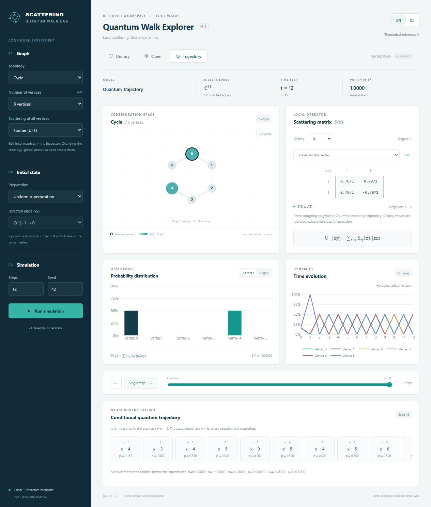

# Scattering Quantum Walk Lab

A local research application for unitary and open Scattering Quantum Walks.
The numerical core uses Python, NumPy, SciPy and NetworkX; FastAPI exposes a
stateless API; React/TypeScript, Cytoscape and Plotly provide the interface.
The mathematical reference is Alain Joye,
[*Unitary and Open Scattering Quantum Walks on Graphs*, arXiv:2409.08428v2](https://arxiv.org/abs/2409.08428v2).

**Convention: `|xy⟩` denotes an edge from `y` to `x`.** Vertex plots in the
edge-walk modes show the incoming vertex marginal, not an induced vertex walk.



[View the same experiment in German](docs/screenshots/lab-de.jpg).

## Languages

The complete interface supports **English (`en`, default)** and **German (`de`)**.
Use the **EN | DE** buttons in the header to switch immediately. The switcher is
keyboard accessible and exposes the active language to assistive technology.
Changing the language preserves the graph, local scattering matrices, matrix
editor drafts, initial state, simulation frames, random seed and current step.
It does not send a new simulation request.

An explicit choice is saved as `sqw.language` in `localStorage` and restored on
reload. Without a stored choice, the application starts in English regardless
of the browser or operating system language. If storage is unavailable, switching
still works for the current page. Missing translations fall back to English.
The document `lang`, page metadata, chart labels, hover text, accessibility text,
validation messages and existing error banners update with the language.

Observable values use locale-aware presentation. Matrix JSON, numerical inputs,
mathematical expressions, graph labels and API identifiers retain their canonical
representation. The Python core and machine-facing API remain language-neutral.

## Installation

Requirements: Python 3.11 or later, Node.js 22 LTS or later, and pnpm.
Run these commands from the repository root. No database, cloud credentials or
user accounts are required.

Windows / PowerShell:

```powershell
py -3 -m venv .venv
.\.venv\Scripts\python.exe -m pip install -e ".[api,dev]"
cd frontend
pnpm install --frozen-lockfile
cd ..
```

If pnpm is unavailable, install it with `npm install --global pnpm@11`.
The included pnpm lockfile fixes the resolved frontend versions.
`pnpm-workspace.yaml` permits the esbuild installation step and keeps the local
package store in the ignored `tmp/` directory.

macOS / Linux:

```bash
python3 -m venv .venv
.venv/bin/python -m pip install -e '.[api,dev]'
cd frontend
pnpm install --frozen-lockfile
cd ..
```

For Python/notebook use alone, `python -m pip install -e .` is sufficient.
API and test dependencies are optional extras. `requirements-tested.txt` records
the Python versions used in the initial validation run. To reproduce that set,
install it before installing this project in editable mode.

## Run locally

Terminal 1, from the repository root (PowerShell):

```powershell
.\.venv\Scripts\python.exe -m uvicorn sqw.api.app:app --host 127.0.0.1 --port 8000
```

Terminal 2:

```powershell
cd frontend
pnpm dev
```

Open [the application](http://127.0.0.1:5173) or
[the API documentation](http://127.0.0.1:8000/docs).
Vite proxies `/api` to port 8000. On macOS/Linux, use `.venv/bin/python` in the
first command. Stop each server with `Ctrl+C`; add `--reload` to uvicorn for
backend development.

In the Codex environment used to develop this repository, dependencies are
already installed in `.venv/` and `frontend/node_modules/`. If pnpm is not on
PATH, the frontend can also be started with:

```powershell
cd frontend
node node_modules/vite/bin/vite.js --host 127.0.0.1
```

## Try an experiment and both languages

1. Select a path or cycle with three vertices and Grover or DFT scattering.
2. Click a vertex to inspect its matrix and explicit neighbor ordering.
3. Select a directed basis state or the coherent uniform superposition.
4. Choose unitary evolution, the open edge walk, or a quantum trajectory, then
   run the simulation. Inspect single steps and the history slider.
5. Switch to **DE**. The same graph, matrices, current step and computed values
   remain in place; labels and observable formatting change immediately.
6. Reload to verify German persists, then choose **EN** and reload again to
   verify the English preference. Reloading itself starts a fresh experiment;
   only the language preference is persisted at present.

Custom matrix entries use `[real, imaginary]` pairs with standard JSON decimal
points in both languages. Invalid dimensions and nonunitary matrices are
rejected. Hadamard is defined only for degree 2; on a path it can be applied
locally at an interior vertex while endpoints keep their 1×1 matrices.

## Use without the web application

```python
from sqw.core import (
    GraphModel, ScatteringWalk, ReferenceTrajectory,
    scattering_matrix, uniform_state, density_from_state,
)

graph = GraphModel.preset("cycle", 3)
walk = ScatteringWalk(graph, {
    x: scattering_matrix("dft", graph.degree(x)) for x in graph.vertices
})
psi0 = uniform_state(graph)
rho5 = walk.evolve_density(density_from_state(psi0), 5)[-1]
path = ReferenceTrajectory(walk, seed=42).run(psi0, 5)
print(walk.vertex_probabilities(rho5), path.outcomes)
```

Construct custom graphs with
`GraphModel.from_edges([0, 1, 2], [(0, 1), (1, 2)])` or
`GraphModel.from_networkx(g)`. The core also accepts arbitrary validated
normalized complex vectors and mixed density matrices.

`from sqw.core import InducedVertexWalk` provides the independent Section-6
channel: `vertex = InducedVertexWalk(walk, omega=None, beta=None)`.
Defaults are uniform local vectors and zero phases. `boundary_operator`,
`theta`, `chi`, `kraus_operators()`, `markov_matrix` and `evolve_density()`
are available for research and diagnostics. This model is implemented in
Python; its separate API and interface remain planned.

Run the reproducible example with:

```powershell
.\.venv\Scripts\python.exe examples/edge_walk.py
```

## Tests and build

```powershell
.\.venv\Scripts\python.exe -m pytest -q
cd frontend
pnpm test
pnpm build
```

Python tests cover analytic path/triangle examples, nonsymmetric complex
scattering matrices, unitarity, Kraus completeness, trace preservation,
positivity, coherence, measurement order, seeds, full ensemble density matrices,
the vertex channel and API validation. Language-related API tests verify that
stable error codes are additive and language preferences do not alter results.
Frontend tests cover translation completeness, language defaults/persistence,
fallbacks and state-preserving switching. The build runs TypeScript and Vite.
See [the validation record](docs/validation.md) for actual executed checks.

## Translation structure and additional languages

`frontend/src/i18n/index.ts` configures i18next/react-i18next with bundled
resources and English fallback. Resources use matching namespaces:

```text
frontend/src/i18n/
  index.ts
  format.ts
  locales/
    en/{app,components,errors}.json
    de/{app,components,errors}.json
```

- `app`: application layout, controls, terminology, counts and help.
- `components`: graph interaction, matrix editor and scientific chart text.
- `errors`: localized stable API error codes and request-validation messages.

To add a language, copy all three English namespace files to a new language
folder, translate their values while preserving keys and interpolation tokens,
then import/register them in `resources` and `supportedLanguages` in `index.ts`.
Add the locale's number-format configuration in `format.ts` if needed. Retain
English fallback. Do not translate model IDs, equations, matrix JSON or protocol
field names. Extend the completeness/persistence tests for the new language,
then run the frontend tests and production build.

API errors keep the original English `detail` for compatibility and add stable
`code`, `params`, and (for schema errors) `issues`. The frontend stores these
descriptors and translates them while rendering, so an already visible error
also changes language. Unknown future server errors receive a localized generic
message rather than exposing a missing translation key or arbitrary server text.

## Scope and remaining work

Implemented: graph presets and custom graphs in the core, local matrix presets
and complex inputs, unitary/open edge dynamics, pure/mixed reference
trajectories, the Python vertex channel, stateless API, bilingual interactive
interface, scientific plots and validation.

Planned: free graph editing, vertex configuration in the API/interface, large
trajectory ensembles in the UI, validated Markov optimizations, spectral
analysis, stationary states, and full experiment import/export. Prepared but
unavailable interface features remain disabled.

Dense density-matrix methods target small reference systems. The interactive
API limits graph size and step count; the Python library has no such UI limits
but retains the underlying memory and runtime costs.

## Documentation

- [Theory and time indexing](docs/theory.md)
- [Architecture and API contract](docs/architecture.md)
- [Additional mathematical results](docs/mathematical_results.md)
- [Roadmap](docs/roadmap.md)
- [Development instructions](AGENTS.md)

The next research step is to record the user's additional theorems with their
hypotheses, then derive a separately selectable Markov trajectory strategy and
validate it against the existing pure/mixed reference.
