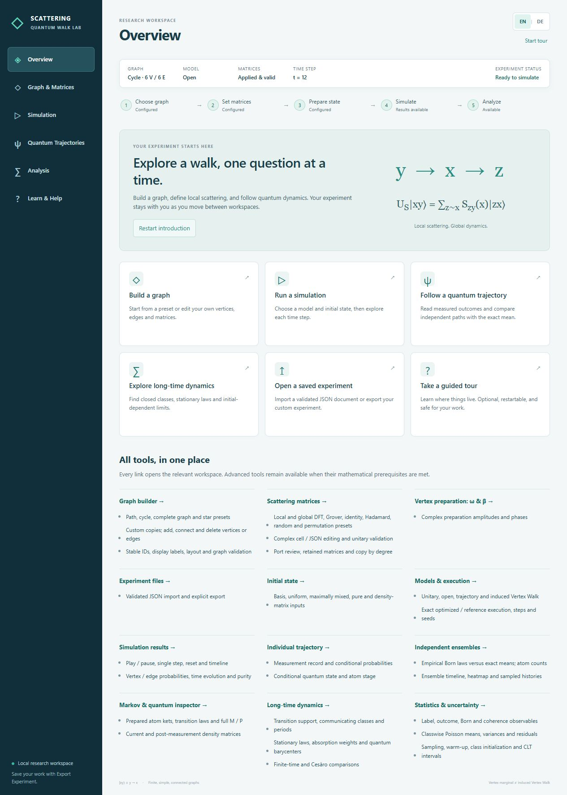

# Scattering Quantum Walk Lab

A local research application for unitary and open Scattering Quantum Walks.
The numerical core uses Python, NumPy, SciPy and NetworkX; FastAPI exposes a
stateless API; React/TypeScript, Cytoscape and Plotly provide the interface.
The mathematical reference is Alain Joye,
[*Unitary and Open Scattering Quantum Walks on Graphs*, arXiv:2409.08428v2](https://arxiv.org/abs/2409.08428v2).

**Convention: `|xy⟩` denotes an edge from `y` to `x`.** Vertex plots in the
edge-walk modes show the incoming vertex marginal, not an induced vertex walk.



[View the German mobile interface](docs/screenshots/ui-mobile-de.png).

## Workspaces and guided help

Start in **Overview**, with direct workflow entry points and a complete feature
directory. **Graph & Matrices** contains presets, custom editing, local matrices,
advanced ω/β preparation and experiment files. **Simulation** groups initial
preparation, all four models, execution, graph probabilities and playback.
**Quantum Trajectories** separates the measurement record, conditional state
and independent ensemble comparison. **Analysis** has dedicated inspector,
long-time and statistics tabs. **Learn & Help** provides concept explanations
and four optional interactive tours.

Navigation retains the experiment, unapplied drafts, computed results and
analysis selections. A live summary and five-step workflow report actual
readiness. Start, skip or restart tours without automatic scientific changes;
language changes also preserve the current tour step. A practice example opens
in a separate tab. Export/import remains the explicit way to save an experiment.
See the [feature inventory and browser validation](docs/ui_ux_redesign.md).

## Languages

The complete interface supports **English (`en`, default)** and **German (`de`)**.
Use the **EN | DE** buttons in the header to switch immediately. The switcher is
keyboard accessible and exposes the active language to assistive technology.
Changing the language preserves the graph, local scattering matrices, matrix
editor drafts, initial state, simulation frames, random seed and current step.
It does not send a new simulation request.

An explicit choice is saved as `sqw.language` in `localStorage` and restored on
reload. Without a stored choice, the application starts in English regardless
of the browser or operating system language. If storage is unavailable, switching
still works for the current page. Missing translations fall back to English.
The document `lang`, page metadata, chart labels, hover text, accessibility text,
validation messages and existing error banners update with the language.

Observable values use locale-aware presentation. Matrix JSON, numerical inputs,
mathematical expressions, graph labels and API identifiers retain their canonical
representation. The Python core and machine-facing API remain language-neutral.

## Installation

Requirements: Python 3.11 or later, Node.js 22 LTS or later, and pnpm.
Run these commands from the repository root. No database, cloud credentials or
user accounts are required.

Windows / PowerShell:

```powershell
py -3 -m venv .venv
.\.venv\Scripts\python.exe -m pip install -e ".[api,dev]"
cd frontend
pnpm install --frozen-lockfile
cd ..
```

If pnpm is unavailable, install it with `npm install --global pnpm@11`.
The included pnpm lockfile fixes the resolved frontend versions.
`pnpm-workspace.yaml` permits the esbuild installation step and keeps the local
package store in the ignored `tmp/` directory.

macOS / Linux:

```bash
python3 -m venv .venv
.venv/bin/python -m pip install -e '.[api,dev]'
cd frontend
pnpm install --frozen-lockfile
cd ..
```

For Python/notebook use alone, `python -m pip install -e .` is sufficient.
API and test dependencies are optional extras. `requirements-tested.txt` records
the Python versions used in the initial validation run. To reproduce that set,
install it before installing this project in editable mode.

## Run locally

Terminal 1, from the repository root (PowerShell):

```powershell
.\.venv\Scripts\python.exe -m uvicorn sqw.api.app:app --host 127.0.0.1 --port 8000
```

Terminal 2:

```powershell
cd frontend
pnpm dev
```

Open [the application](http://127.0.0.1:5173) or
[the API documentation](http://127.0.0.1:8000/docs).
Vite proxies `/api` to port 8000. On macOS/Linux, use `.venv/bin/python` in the
first command. Stop each server with `Ctrl+C`; add `--reload` to uvicorn for
backend development.

In the Codex environment used to develop this repository, dependencies are
already installed in `.venv/` and `frontend/node_modules/`. If pnpm is not on
PATH, the frontend can also be started with:

```powershell
cd frontend
node node_modules/vite/bin/vite.js --host 127.0.0.1
```

## Try an experiment and both languages

1. Select a path or cycle with three vertices and Grover or DFT scattering.
2. Click a vertex to inspect its matrix and explicit neighbor ordering.
3. Select a localized basis state, coherent uniform superposition or maximally
   mixed state. The separate vertex mode uses a vertex-space initial state.
4. Choose unitary evolution, the open edge mean, an edge trajectory, or the
   induced vertex walk. Select **Optimized** or **Reference**, then run, step,
   play/pause, reset or inspect the history slider.
5. Switch to **DE**. The same graph, matrices, current step and computed values
   remain in place; labels and observable formatting change immediately.
6. Reload to verify German persists, then choose **EN** and reload again to
   verify the English preference. Reloading itself starts a fresh experiment;
   only the language preference is stored automatically. Export/import retains custom experiments.

Custom matrix entries accept real numbers, `a+bi`, and `[real, imaginary]` JSON
pairs with standard decimal points in both languages. Invalid dimensions and nonunitary matrices are
rejected. Hadamard is defined only for degree 2; on a path it can be applied
locally at an interior vertex while endpoints keep their 1×1 matrices.

## Draw and save a custom graph

Select **Custom Graph** to draw vertices and connect pairs on the existing
canvas. **Select / Move**, **Add Vertex**, **Add Edge**, and **Delete** separate
editing actions. List-based controls support keyboard and narrow screens.
Labels can change without changing numeric IDs; dragging only changes layout.
**Customize this graph** makes an independent copy of any existing preset.
Switching back to a preset preserves the custom draft for the current page.

A finished graph must be connected, simple, loopless, and have at least two
vertices. Incomplete drafts are allowed, but simulations and analyses are
blocked until the graph, matrices, active initial state, and applicable Vertex
parameters are valid. Neighbor changes retain old scientific entries and ask
for explicit review; unaffected matrices survive. A typed matrix is checked
locally and by the same backend validator before it is applied.

**Export Experiment** downloads version-one JSON with IDs, labels, positions,
explicit ports, complex matrices, omega/beta, the active initial state and main
simulation controls. **Import Experiment** validates before replacing anything;
existing custom data requires confirmation. Export valid experiments before
closing/reloading; there is no automatic draft persistence.

Try [the browser-tested three-vertex example](examples/custom_path_phase.json):
Hadamard at B, U(1) phase i at A, Identity at C, initial |1,0>, seed 42.
It works with the existing unitary/open/trajectory/Vertex engines and all
research panels. See [the editor and JSON guide](docs/custom_graphs.md) for
port semantics, seed behavior, limits and a complete click-through recipe.

## Use without the web application

```python
from sqw.core import (
    GraphModel, ScatteringWalk, ReferenceTrajectory,
    scattering_matrix, uniform_state, density_from_state,
)

graph = GraphModel.preset("cycle", 3)
walk = ScatteringWalk(graph, {
    x: scattering_matrix("dft", graph.degree(x)) for x in graph.vertices
})
psi0 = uniform_state(graph)
rho5 = walk.evolve_density(density_from_state(psi0), 5)[-1]
path = ReferenceTrajectory(walk, seed=42).run(psi0, 5)
print(walk.vertex_probabilities(rho5), path.outcomes)
```

Construct custom graphs with
`GraphModel.from_edges([0, 1, 2], [(0, 1), (1, 2)])` or
`GraphModel.from_networkx(g)`. The core also accepts arbitrary validated
normalized complex vectors and mixed density matrices.

`from sqw.core import InducedVertexWalk` provides the independent Section-6
channel: `vertex = InducedVertexWalk(walk, omega=None, beta=None)`.
Defaults are uniform local vectors and zero phases. `boundary_operator`,
`theta`, `chi`, `kraus_operators()`, `markov_matrix` and `evolve_density()`
are available for research and diagnostics. This model is implemented in
Python and the separate **Vertex Walk** mode in the API/interface. Its controls
accept complex boundary vectors and real phase parameters as JSON, in the
explicit neighbor order shown by the matrix editor.

Exact Markov strategies are separate from the reference:

```python
from sqw.core import EdgeReduction, OptimizedEdgeTrajectory, run_ensemble

reduction = EdgeReduction(walk)
session = OptimizedEdgeTrajectory(reduction, seed=42).start(psi0)
first = session.step()                # only X1 is sampled
second = session.step()               # first guaranteed scattered edge atom
print(second.atom_id, second.ket())   # coherent U|e>, not basis ket |e>
mean5 = list(reduction.iter_mean(psi0, 5))[-1]
print(mean5.atom_weights, mean5.born_edges())  # q5 versus M @ q5
ensemble = run_ensemble(walk, psi0, 10000, 20, seed=42,
                        strategy="optimized", selected_histories=3)
print(ensemble.frames[-1].born_vertex_total_variation)
```

`OptimizedEdgeTrajectory.run(..., initialization="direct")` samples the exact
joint `q2` law for batch starts. `OptimizedVertexTrajectory` and `VertexReduction`
provide the corresponding vertex-label operations. Arbitrary complex pure and
mixed states work through the Python API and JSON `initial.vector` /
`initial.density` fields; the browser includes both JSON editors alongside the
three preset preparations, with explicit basis review after graph changes.

In open/trajectory/vertex modes, the **Ensemble and exact mean** panel compares
independent-path empirical Born probabilities with the exact mean, displays
total-variation errors, preparation-label counts, selected histories and a time
heatmap. The **Markov and quantum-state inspector** shows selected atoms, complex
kets, transition probabilities, explicit M/P orientation and the current density.
Conditional paths also expose the state after measurement before scattering.
Language switching preserves these results, parameter drafts and playback.

The **Long-Time Dynamics** panel analyzes communicating and closed classes,
transients, gcd periods, the complete stationary family and initial-state
absorption mixtures. Its separate graph uses directed-edge atoms in Edge mode
and preparation labels in Vertex mode. Inspect outgoing probabilities, the
original M/P matrix, ordinary and Cesàro curves, TV distances and a selected
stationary quantum density. Changing language retains results and selections.
Numerical support cutoffs are explicit: omitting a genuine tiny rate can change
an infinite-time answer. See [the stationary-analysis guide](docs/stationary_analysis.md).

```python
from sqw.core import StationaryAnalysis

analysis = StationaryAnalysis(walk)  # or InducedVertexWalk / either reduction
print([(c.states, c.period) for c in analysis.chain.closed_classes])
print(analysis.mixture(psi0).class_weights)
rho_stationary = analysis.stationary_density(psi0)
frames = list(analysis.evolve(psi0, 200))  # t=2..202 for Edge; t=1..201 for Vertex
```

Run the reproducible example with:

```powershell
.\.venv\Scripts\python.exe examples/edge_walk.py
.\.venv\Scripts\python.exe examples/stationary_analysis.py
```

## Tests and build

```powershell
.\.venv\Scripts\python.exe -m pytest -q
cd frontend
pnpm test
pnpm build
```

In this workspace, if `pnpm` is not on PATH, the installed fallback can run
the same frontend commands (PowerShell, from the repository root):

```powershell
$sqwPnpm = 'C:\Users\david\.cache\codex-runtimes\codex-primary-runtime\dependencies\bin\fallback\pnpm.cmd'
Push-Location frontend
& $sqwPnpm test
& $sqwPnpm build
Pop-Location
```

Python tests cover analytic path/triangle examples, nonsymmetric complex
scattering matrices, unitarity, Kraus completeness, trace preservation,
positivity, coherence, measurement order, seeds, full ensemble density matrices,
the vertex channel and API validation. Language-related API tests verify that
stable error codes are additive and language preferences do not alter results.
Frontend tests cover translation completeness, language defaults/persistence,
fallbacks and state-preserving switching. The build runs TypeScript and Vite.
See [the validation record](docs/validation.md) for actual executed checks.

## Translation structure and additional languages

`frontend/src/i18n/index.ts` configures i18next/react-i18next with bundled
resources and English fallback. Resources use matching namespaces:

```text
frontend/src/i18n/
  index.ts
  format.ts
  locales/
    en/{app,components,research,stationary,statistics,errors}.json
    de/{app,components,research,stationary,statistics,errors}.json
```

- `app`: application layout, controls, terminology, counts and help.
- `components`: graph interaction, matrix editor and scientific chart text.
- `research`: exact strategies, vertex parameters, ensembles and state inspection.
- `stationary`: communicating classes, support policy, stationary laws and long-time charts.
- `statistics`: Poisson diagnostics, classwise CLTs, atom observables and trajectory uncertainty.
- `errors`: localized stable API error codes and request-validation messages.

To add a language, copy all six English namespace files to a new language
folder, translate their values while preserving keys and interpolation tokens,
then import/register them in `resources` and `supportedLanguages` in `index.ts`.
Add the locale's number-format configuration in `format.ts` if needed. Retain
English fallback. Do not translate model IDs, equations, matrix JSON or protocol
field names. Extend the completeness/persistence tests for the new language,
then run the frontend tests and production build.

API errors keep the original English `detail` for compatibility and add stable
`code`, `params`, and (for schema errors) `issues`. The frontend stores these
descriptors and translates them while rendering, so an already visible error
also changes language. Unknown future server errors receive a localized generic
message rather than exposing a missing translation key or arbitrary server text.

## Scope and remaining work

Implemented: reusable graph presets and interactive custom graphs, complex scattering,
unitary/open edge dynamics, independent reference and exact optimized edge and
vertex trajectories/means, compact ensembles, stateless API, bilingual controls,
playback, heatmaps, quantum/Markov inspection, stationary families, periods,
absorption, long-time analysis, centered Poisson solvers and classwise trajectory
uncertainty, pure/mixed initial-state editors, and validated experiment files.
See the result-ID mapping below.

Planned: finite-atomic MMD and spectral/RKHS analysis, draft autosave/undo and
backend job cancellation. Multigraphs,
partial observations and time-dependent coins are explicitly unsupported.

Dense density-matrix methods target small reference systems. The interactive
API limits graph size and step count; the Python library has no such UI limits
but retains the underlying memory and runtime costs.
The vertex reduction uses sparse chi/P after construction, but its existing
reference-model constructor still allocates dense diagnostic arrays. The API
is stateless and replays requested prefixes; Python online sessions avoid replay.

Run the actual runtime/allocation benchmark with:

```powershell
.\.venv\Scripts\python.exe examples/benchmark_markov.py
```

See [measured benchmarks](docs/benchmarks.md) for results and memory methodology.
The original `Material/reference_checks.py` intentionally still reproduces its
T34 failure. `pytest tests/test_reference_handoff.py -q` runs the documented,
independent corrected copy with unchanged assertions and tolerances.

## Documentation

- [Theory and time indexing](docs/theory.md)
- [Architecture and API contract](docs/architecture.md)
- [Stationary algorithms, examples and limitations](docs/stationary_analysis.md)
- [Poisson equations, CLTs and trajectory uncertainty](docs/trajectory_statistics.md)
- [Additional mathematical results](docs/mathematical_results.md)
- [Handoff audit and T34 correction](docs/mathematical_audit.md)
- [Measured benchmarks](docs/benchmarks.md)
- [Roadmap](docs/roadmap.md)
- [Development instructions](AGENTS.md)

The next research step is support-sensitivity diagnostics and finite-atomic
MMD with explicit stationary-start assumptions. Sparse vertex construction
remains the main scaling prerequisite.

## Trajectory statistics (Phase 4)

In any open Edge/Vertex mode, use **Trajectory Statistics & Uncertainty**
(**Trajektorienstatistik & Unsicherheit**). Select an atom/outcome indicator,
next Born probability or Hermitian coherence; choose N, warm-up and a trajectory
seed. Inspect recurrent classes, absorption probabilities, means, periods,
Poisson residuals and correlated standard errors. Running means are compared
with a selected class mean and, when justified, a pointwise asymptotic band.
Class selection and English/German switching preserve the sampled path.

The Python core and `/api/statistics` also accept arbitrary real label values
and Hermitian matrices. Edge atoms start at t=2, Vertex atoms at t=1.
Observations are correlated; the displayed IID error is only a comparison.
Periodic irreducible chains are supported. Reducible chains retain conditional
CLTs, transient mass and random class-dependent limits. Zero variance gives no
nondegenerate Gaussian interval and does not eliminate finite-length bias.

```python
from sqw.core import PoissonSolver, TrajectoryStatistics

solution = PoissonSolver([[2/3, 1/3], [1/3, 2/3]]).solve([1, 0])
assert abs(solution.asymptotic_variance - 0.5) < 1e-14
# For a previously constructed ScatteringWalk or InducedVertexWalk:
statistics = TrajectoryStatistics(walk)
f = statistics.observable('label_indicator', index=0)
classes = statistics.analyze(initial, f)
path = statistics.sample(initial, f, 10000, seed=42, max_points=501)
```

Run the seeded long-trajectory benchmark with
`python examples/trajectory_statistics.py`. Its measured results, analytical
checks and limitations are in [the validation record](docs/validation.md).
Each tested milestone is committed locally; remote pushes require explicit
authorization. The application remains local and needs no new dependencies.
