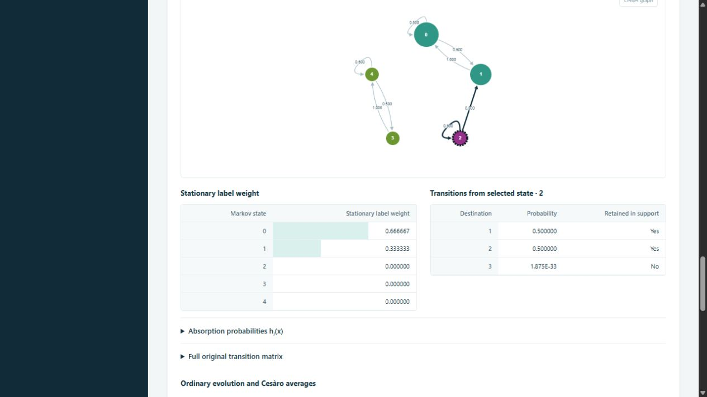

# Finite stationary and long-time analysis

Phase 3 implements E-06/E-07, the stationary part of V-04, V-05 and NEW-04,
including AUD-01 and the exact neighbor order of X-04. E-08 and E-11 inform
the distinction between classical and quantum convergence; full spectra and
unconditional SLEM bounds are not implemented. The supplied handoff, Joye's
finite-state hypotheses and the independent Kraus reference remain the sources;
numerical regression tests do not prove theorems.

## Orientations, objects and time

| Model | Original transition | First atom law | Stationary barycenter |
| --- | --- | --- | --- |
| Open Edge | column M, q_next=M q | q2 from full incoming coherence blocks, t=2 | U diag(pi) U† |
| Induced Vertex | row P, q_next=q P | r0=diag(rho0), t=1 | sum_x pi[x] chi(x)chi(x)† |

`StationaryAnalysis` explicitly supplies T=M.T or T=P to the generic
row-stochastic `MarkovAnalysis`. Matrices in the interface retain the original
orientation. `evolve(initial, L)` includes L+1 laws, from t=2 to t=2+L for
Edge or t=1 to t=1+L for Vertex. Each running Cesàro average includes the
first atom law and every subsequent law through the displayed time; it does
not include the pre-atom warmstart. The two TV distances always use the
input-dependent stationary mixture, even when inspecting another class.

The invariant quantum measure is the pushforward of the stationary label law
onto atom projectors. `invariant_measure()` returns weighted labels, whose
states are available lazily through `model.atom_density(label)`. Edge labels
are integer indices in `graph.directed_edges`; Vertex labels are actual vertex
names. Duplicate Vertex projectors are retained as labels and implicitly sum
under pushforward. No approximate projector merging is performed. A measure
over pure states and its mixed density barycenter are different objects.

## Support policy and its limitations

The core rejects negative, nonfinite, nonreal or nonsquare transition matrices;
raw row sums must agree with one to absolute tolerance 1e-10. It retains a
detached original CSR matrix. Classification acts on a separate **analysis
matrix**: remove excluded entries, then normalize each retained row.

1. A caller-declared positive-support mask takes precedence. Marked entries
   must be positive; excluded entries must be no larger than the validation
   tolerance. This is caller knowledge, not a mathematical proof inferred by
   the solver. Generic masks use row convention; the SQW adapter accepts masks
   in its model's original convention.
2. Exactly recognized built-in coins supply analytical masks. Edge supports
   cover Identity, Grover, DFT and degree-two Hadamard. Vertex support also
   requires exactly uniform boundary vectors. DFT/Hadamard prepares the first
   stored neighbor, plus a self component when that neighbor has degree >1;
   Identity/Grover prepares every neighbor and has self support when any
   neighbor has degree >1. Recognition uses exact array equality, never
   `allclose`. Edited/general matrices conservatively fall back to rule 3.
3. Otherwise the numerical convention excludes probabilities <= `support_atol`
   (default 1e-14). Cutoff zero retains every stored positive value, including
   floating-point artifacts. Neither choice automatically certifies exact zeros.

Reports include support source, discarded entry count, maximum removed entry
and row mass, maximum row L1 change, raw stochasticity and raw stationarity/
absorption residuals. Finite-time curves use **original probabilities**, with
the existing checked-probability normalization for roundoff; the stationary
reference and structural conclusions use the analysis matrix. Python callers
can choose `chain.evolve(..., use_analysis_matrix=True)` for that separate chain.

Removing a genuine 1e-16 escape rate can turn a transient state into a closed
class and change its infinite-time limit completely. A small residual or small
row perturbation is **not** an asymptotic error bound. The interface exposes
this distinction and the original quantum-channel fixed-point residual. It
never edits chi, U or the original transition operator to impose its support
decision. Full rank/conditioning certificates and interval arithmetic are not
provided; extremely ill-conditioned solves can be rejected.

## Structural and linear-algebra algorithms

SciPy's directed strong-component algorithm partitions the positive support.
A class is closed if no retained transition leaves it. In a finite chain,
closed irreducible classes are recurrent; every other state is transient.
Class IDs are deterministic, sorted by their smallest state index. A unique
closed class gives a unique stationary law even if transient states make the
whole chain reducible.

For each SCC, directed breadth-first depths l(x) give

```text
period = gcd {|l(x)+1-l(y)| : x -> y inside the class}.
```

Residues l(x) modulo the period give cyclic subclasses. A transient singleton
with no self-loop has no return cycle and reports period=null. A self-loop
forces period one. No eigenvalue rounding decides periods.

For each closed class, solve normalized stationarity independently. The code
forms an off-diagonal generator `A = off(T) - diag(off(T) 1)`, transposes and
scales it, replaces one balance equation by sum(pi)=1, and uses a sparse solve.
Using off-diagonal exit rates avoids cancellation in `1-T[x,x]` for genuine
rates far below machine spacing near one. Scaled residual, positivity and
normalization checks reject invalid solutions; no arbitrary eigenvector is
selected from a degenerate eigenspace. Extended class laws are CSR rows of
`stationary_basis`. Every stationary law is a convex combination of these rows.

For transient states F and recurrent classes C_j, let Q=T[F,F] and
R[x,j]=sum_(y in C_j) T[x,y]. Absorption solves `(I-Q) H_F = R`, with H=1 for
the matching class and zero for other closed classes. The implementation
divides by each transient state's off-diagonal exit rate first (embedded jump
chain), preserving very small exits and avoiding explicit matrix inversion.
It checks harmonic residuals and that every H row is a probability law.

For initial q, `a=q H` and `pi_initial=sum_j a[j] pi_j`. This includes **all**
transient initial mass (AUD-01); mass already in C_j is not the full answer.
The solver stores H as CSR; a transient-by-class dense right-hand side is
needed during absorption solves. A chain of 500 isolated absorbing states
uses 500 nonzeros in H and the stationary basis, not dense n-by-n core storage.
The bounded interactive API serializes full stationary/absorption tables.

## Convergence statements

For a finite chain, Cesàro laws always approach the absorption mixture.
Ordinary laws approach it for all inputs supported in a basin when every
reachable closed class is aperiodic. The implementation determines reachability
combinatorially from the initial positive support, not from rounded class
weights. A reachable periodic class removes this general guarantee: a specially
chosen stationary input can still be constant. No finite chart proves a limit.

For Edge, bistochasticity implies there are no transient states and each
closed class has a uniform stationary law. Global uniform pi is always
stationary and has barycenter I/|D|, but need not be unique. Orthogonality of
U|e> gives equality between label TV distance and trace distance of barycenters.
For Vertex, pi need not be uniform, and the barycenter need not be maximally
mixed even if P is bistochastic. Its trace distance is at most label TV;
nonorthogonal/duplicate atoms prevent a general equality or converse.

Under the exact model support, convergence of label laws gives convergence
in law of conditional states and convergence of their mean densities. A
single instantaneous pure state does not converge to a mixed barycenter.
A single trajectory eventually enters one recurrent class and its empirical
time average approaches that class's invariant measure/barycenter, even when
the class is periodic. The ensemble mixture averages over which class is
selected; it is not generally the empirical limit of each individual path.

## Examples and independent validation

Run `python examples/stationary_analysis.py`. It compares every reduced mean
against successive independent channel applications for 120 additional
transitions, including the correct one/two-step warmstart.

| Example | Closed classes / periods | Stationary result | Maximum mean/Kraus entry error |
| --- | --- | --- | --- |
| Edge path3 Identity | 2 / 2,2 | basis input selects (1/2,1/2,0,0) | 0 |
| Edge path3 Hadamard (interior only) | 1 / 2 | uniform 1/4 | 4.72e-15 |
| Edge path3 Swap (degree-two Grover) | 1 / 4 | uniform 1/4 | 0 |
| Edge triangle DFT | 1 / 1 | uniform 1/6; barycenter I/6 | 3.39e-15 |
| Vertex X-04, initial vertex 2 | 2 / 1,1; transient 2 | (2/3,1/3,0,0,0) | 2.69e-14 |
| Vertex triangle, complex omega and beta | 1 / 1 | approximately (.404461,.321190,.274349) | 4.11e-16 |

Maximum stationary-channel residual in that run: 2.22e-16. At t=122 the
ordinary Edge TV distances are .5, .5, .75 and approximately 5.55e-17 in the
first four examples, while their Cesàro distances are approximately .004132,
.006198, .006198 and .003673. These are measured finite-time values, not bounds.

X-04 uses the path 0-1-2-3-4 with port order `3:[4,2]` and ascending order
elsewhere. Since GraphModel stores ascending ports, the example conjugates
the DFT at vertex 3 by the 2-by-2 swap on **both rows and columns**. Its P is

```text
1/2  1/2   0    0    0
 1    0    0    0    0
 0   1/2  1/2   0    0
 0    0    0    0    1
 0    0    0   1/2  1/2
```

Classes are {0,1}, {3,4}; h_{left}(2)=1. Uniform-omega generalized Grover
regressions also cover paths, stars and triangles: uniform stationary labels
and aperiodicity when |V|>2; the two-vertex path has period two. Separate tests
cover mixed periods, fractional absorption, deterministic cycles, tiny genuine
rates, invalid inputs, beta cache reuse and complex stationary densities.

## API, UI and cost boundaries

`POST /api/stationary` is stateless. A bounded LRU stores structural models
keyed by full graph/coin/omega bytes and cutoff. Initial-state or horizon changes
reuse the structure; beta changes reuse P and rebuild phase-sensitive chi.
Graph, scattering, omega or cutoff changes invalidate the key. In-process
cached results are reused across requests; there is no persistent experiment
store. See [architecture](architecture.md) for request fields and budgets.

The interface has class/period tables, stationary selectors and bars, a separate
Markov graph with a class-color legend, dashed transient borders, outgoing
transition highlighting, absorption tables, full matrices up to dimension 64,
and sparse per-source inspection otherwise. Above 80 states the graph shows
the selected state and its outgoing neighborhood. All tables still cover the
chain. Density reconstruction is optional and limited to dimension 64.
English/German switching preserves the analysis, state/class selections and
time cursor, and triggers no API request.



[German periodic/Cesàro example](screenshots/stationary-de.png).

No full quantum superoperator is built. Sparse direct solves can incur fill-in;
the existing Vertex constructor still creates dense reference diagnostics.
The interface caps histories at 250000 state-time entries and 5000 reduced
transitions. Sparse spectra, period-specific subsequential limits, exact
duplicate-projector quotients, single-path CLTs, infinite graphs, parallel
ports and time-dependent instruments remain outside this phase.
